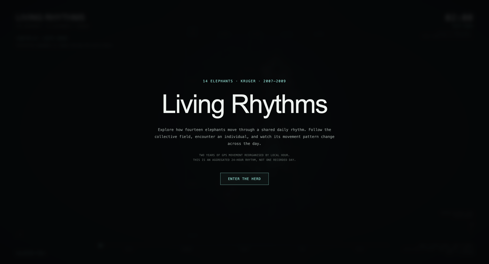
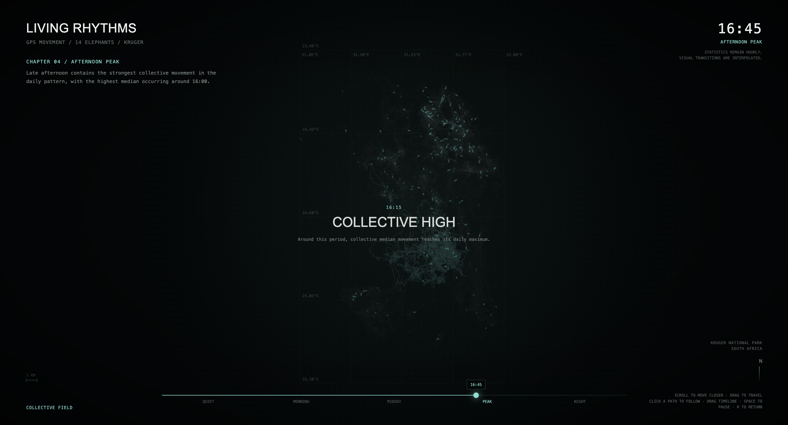
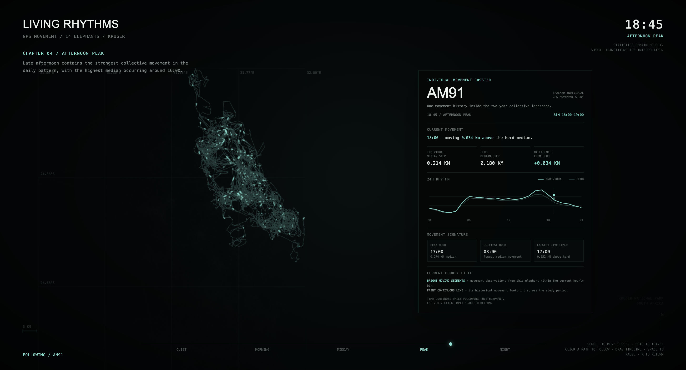

# Living Rhythms

## Project Overview

**Living Rhythms** is an interactive web experience that explores the daily movement rhythms of 14 tracked African elephants in Kruger National Park.

The project extends my previous elephant movement data visualisation into a more spatial and narrative interactive experience. Instead of only reading a static chart, users can move through the landscape, follow changes across a 24-hour rhythm, and select an individual elephant to compare its movement pattern with the collective herd.

The main idea is to turn movement data into an explorable environment where the user can move between three levels:

- **Collective level** — observe the movement rhythm of all 14 elephants.
- **Individual level** — select one elephant and inspect its historical movement footprint.
- **Hourly level** — compare that elephant's movement during the current hourly period with the herd median.

The 24-hour experience is based on movement data aggregated by local hour across the full study period, rather than representing one single recorded day.

---

## Screenshots

### Opening View



### Collective Movement View



### Individual Elephant View



## Intended User

The experience is designed for a general audience interested in animal movement, environmental data, and interactive data storytelling.

No specialist knowledge is required. The interface provides contextual interaction hints so users can discover the main controls while exploring.

---

## Main Interaction

The experience begins automatically after the user selects **ENTER THE HERD**.

Users can:

- **Move the pointer across trajectories** to discover tracked elephants.
- **Click a trajectory** to follow one elephant and open its individual movement dossier.
- **Drag the timeline** to inspect different times of day.
- **Scroll** to zoom into the spatial landscape.
- **Drag the map** to explore the movement field.
- Press **Space** to pause or resume automatic time progression.
- Press **R** or **Esc** to return from an individual elephant to the collective view.

When an elephant is selected, the interface displays:

- its historical movement footprint,
- current hourly movement segments,
- its median movement compared with the herd median,
- a 24-hour individual-versus-herd rhythm chart,
- peak hour,
- quietest hour,
- and the hour of largest divergence from the herd.

The main interaction loop is:

**user action → visual/data response → feedback → next exploration decision**

For example, selecting an elephant changes the spatial focus, movement display, statistical information, and rhythm chart, allowing the user to decide whether to inspect another time or return to the collective field.

---

## How to Run

This is a browser-based project and should be opened through a local web server rather than by opening the HTML file directly.

From the project folder, run:

```bash
uv run python -m http.server 8000
```

Then open:

```text
http://localhost:8000/spatial_exploration.html
```

The main browser data file is:

```text
out/interactive_tracks.json
```

The data preparation script is:

```text
prepare_interactive.py
```

---

## Data

The project uses elephant movement data from Movebank:

**ThermochronTracking Elephants Kruger 2007**

DOI:

**10.5441/001/1.403h24q5**

The dataset contains GPS tracking records for 14 adult female African elephants in Kruger National Park between 2007 and 2009.

Movement is calculated from consecutive GPS observations approximately 29–31 minutes apart using straight-line geographic displacement.

The collective and individual movement rhythms are summarised using median movement distance for each local hour of the day.

The browser visualisation uses systematically downsampled trajectory and movement data for performance, while the hourly statistical summaries are calculated from the full set of valid movement steps.

---

## Known Limitations

- The 24-hour experience is an **aggregated daily rhythm**, not one continuous real day.
- The underlying movement statistics are calculated in **hourly bins**. Visual transitions between hours are interpolated to make the animation smoother.
- The faint individual trajectory represents the elephant's **historical movement footprint across the full study period**, not a single-day migration route.
- Bright movement segments represent observations associated with the current hourly bin across the study period.
- The browser visualisation uses downsampled spatial data to improve performance, so not every original GPS point is drawn.
- The project does not include verified photographs or videos corresponding to the specific tracked individual IDs.
- The experience is designed primarily for desktop browsers and may not provide the same interaction quality on small mobile screens.

---

## User Testing

The experience was tested by another user before its interaction was explained.

The tester understood the overall theme and the **ENTER THE HERD** entry point, but initially did not realise that a highlighted trajectory represented one individual elephant. They also felt that chapter transitions were visually abrupt, wanted clearer spatial context, and wanted a way to inspect movement at different times manually.

Based on this observation, the project was refined by:

- adding clearer hover and interaction feedback,
- distinguishing historical footprints from current-hour movement,
- adding geographic grid, scale and location context,
- stabilising the map position across narrative chapters,
- expanding the individual elephant information,
- and adding an interactive timeline for direct time exploration.

More detail about this process is recorded in `PROCESS.md`.

---

## Error and Edge-Case Handling

The project includes several basic responses to ordinary errors or interruptions:

- If the movement data file cannot be loaded, the page displays a clear data-loading error message.
- If an individual elephant has no valid movement value in the current hourly bin, the interface reports that no valid movement step is available rather than displaying a false zero.
- Users can pause automatic playback using **Space**.
- Users can return from an individual view using **R**, **Esc**, or by clicking empty space.

---

## Credits

### Data

Movebank dataset:

**ThermochronTracking Elephants Kruger 2007**  
DOI: **10.5441/001/1.403h24q5**

### AI Assistance

ChatGPT was used during development to support:

- code debugging,
- interaction prototyping,
- visual and interface refinement,
- discussion of alternative interaction structures,
- and documentation planning.

AI-generated suggestions were reviewed and tested rather than used automatically. Some ideas were kept, while others were modified or rejected during development.

For example, the spatial narrative structure was developed from an AI-supported exploration of alternatives to the earlier dashboard-style interface. In contrast, an earlier terrain-based direction and automatic chapter camera movement were later rejected because they reduced clarity or spatial stability.

### Development

The project was developed as part of **SD5913 Creative Programming for Designers and Artists**.

### Code and Media

The final experience uses standard HTML, CSS, JavaScript and the browser Canvas API. No external JavaScript visualisation library or uncredited media is required for the final experience.

The project builds on my own earlier Assignment 2 elephant movement visualisation and its data-processing workflow.

Any external data, code references, libraries, and AI assistance used in the project are documented in this repository.